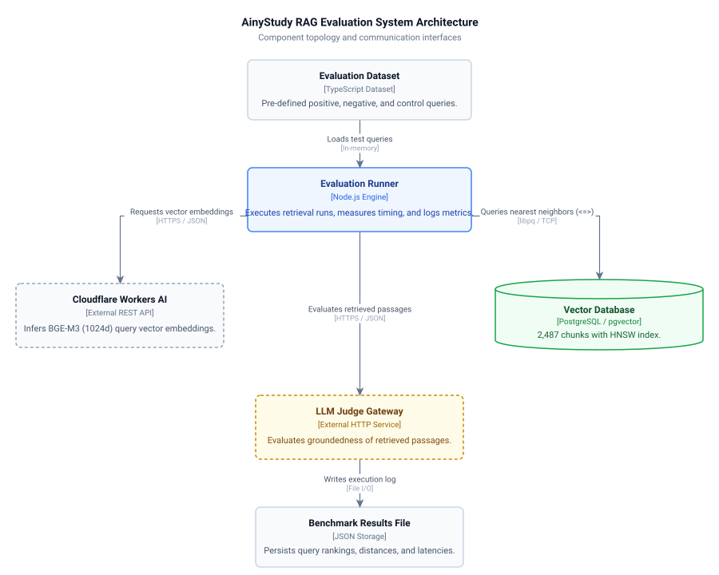

# AinyStudy Vector Retrieval Benchmark

Benchmark suite measuring vector search accuracy and latency on PostgreSQL (`pgvector` HNSW index) using 2,487 production chunks from AinyStudy.



## Results Summary

### Retrieval Accuracy (33 test queries: 27 positive, 5 negative, 1 unanswerable)

| Metric | Score | Note |
|---|---|---|
| Hit@1 | 81.5% | Top-1 chunk matches labeled ground truth |
| Hit@5 | 96.3% | Ground truth appears within top 5 retrieved chunks |
| Groundedness | 84.8% | Verified by LLM judge (100% on positive queries, 0 false-positives on negatives) |
| HNSW Index Recall | 96.4% | Graph traversal recall compared to exact brute-force cosine search |

### Latency (3 iterations per query, 99 total samples)

| Component | P50 | P95 | Note |
|---|---|---|---|
| PostgreSQL pgvector (`<=>`) | 8.2 ms | 16.0 ms | Local database index search time |
| Remote Embedding (BGE-M3) | 255.0 ms | 423.0 ms | Cloudflare Workers AI API request |
| **Total Pipeline** | **263.2 ms** | **439.0 ms** | End-to-end retrieval time |

## How It Works

- `scripts/rag-eval-run.ts`: Main benchmark runner. Queries pgvector, measures isolated timings, and verifies index recall.
- `scripts/rag-eval-dataset.ts`: 33 labeled queries (positive questions, negative controls, near-miss distractors).
- `docs/rag-eval/benchmark-results.json`: Full execution output containing raw timings and rankings.
- `docs/rag-eval/METHODOLOGY.md`: Dataset composition and scoring methodology.

## Quickstart

```bash
# 1. Install dependencies and verify types
pnpm install
pnpm run typecheck

# 2. Configure environment
cp .env.example .env

# 3. Run benchmarks
pnpm run eval:skip-judge   # Run retrieval and latency tests without LLM judge
pnpm run eval              # Run full evaluation including LLM judge groundedness
```

## Next Iterations

- **Hybrid Search**: Combine pgvector HNSW with PostgreSQL full-text search (`tsvector`) using Reciprocal Rank Fusion (RRF).
- **Reranking**: Add a cross-encoder model to rescore top candidates before context slicing.
